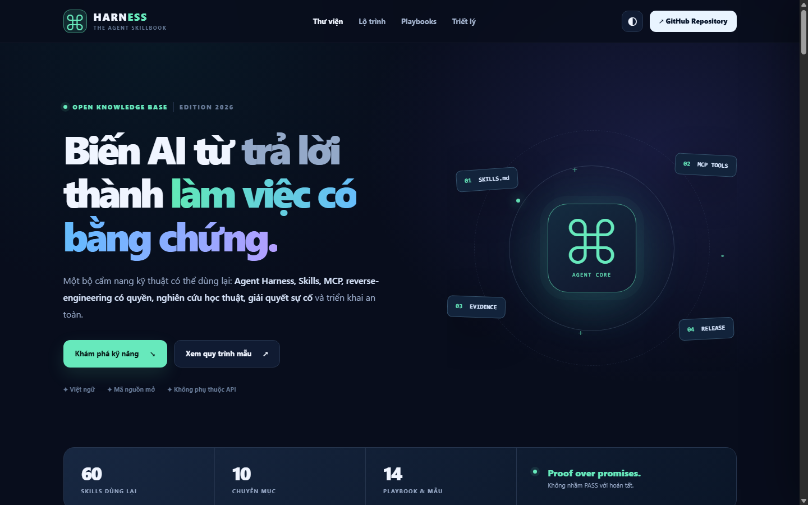

# QA REPORT — Agent Harness Skillbook

> **TRẠNG THÁI MỚI NHẤT — 14/11/2026, 17:08 giờ Việt Nam: 16/16 BROWSER QA PASS TRÊN GITHUB PAGES CÔNG KHAI.** Ba phép thử từng ghi NOT_RUN (Tab focus trap, Escape và Back) hiện đã chạy thực tế và PASS. Kết quả JSON: [browser-qa.json](evidence/2026-11-14-final/browser-qa.json). Mã giao diện đã kiểm thử: `bda13a5e5d83883238ecf7e5db6ee88f9c4a5589`. Phần NOT_RUN phía dưới là **lịch sử kiểm thử cũ, không phải trạng thái hiện tại**.

**Ngày chạy:** 2026-11-14 07:45:40 UTC (14:45:40 Việt Nam)  
**Repo:** trinhtanphat/agent-harness-skillbook  
**Commit kiểm thử:** e4d2f97bebb92670392dc96a67eec6a8f0c7875c  
**Site:** https://trinhtanphat.github.io/agent-harness-skillbook/  
**Môi trường:** DESKTOP-PHA1S90, Chrome headless, profile riêng tự tạo, không đụng Edge/Session 2.  
**Command:** node scripts/browser-qa.mjs https://trinhtanphat.github.io/agent-harness-skillbook/

## 7/7 Browser smoke checks PASS

| Hạng mục | Quan sát |
|---|---|
| Desktop catalog | 60 skills, 11 category buttons, không horizontal overflow ở 1440px |
| Search MCP | 7 kết quả phù hợp, filter hoạt động |
| Category Research | 6 skills, aria-pressed=true |
| Detail drawer | mở và đóng bằng UI thành công |
| Mobile 390px | 60 skills, viewport/scrollWidth đều 390 |
| Playbook mobile | 14 menu links, có heading và không overflow |
| Runtime JS exceptions | 0 |

## Hình ảnh kiểm chứng

[Chi tiết skill](evidence/2026-11-14/skill-detail-desktop.png) · [Trang playbook mobile](evidence/2026-11-14/docs-mobile-390.png)

## MCP protocol tests

Node smoke tests on WIN11-181: discovery, per-request metadata, tool listing, deterministic tool calls, validation error, unknown tool, version mismatch and missing metadata: PASS. Protocol revision: **2026-07-28**, reference: https://modelcontextprotocol.io/specification/2026-07-28.

## Giới hạn

- Đây là kiểm thử smoke, không phải nghiệm thu mọi tương tác và nội dung của 60 skill.
- Screenshot không thay cho human pixel-level art review.
- Trang tĩnh không thao tác hệ thống production và không có backend người dùng.
- GitHub Pages / commit cần kiểm tra lại sau mỗi cập nhật, không tự áp dụng kết quả cũ cho commit mới.
- Thông tin và mã ví dụ chỉ dùng cho nghiên cứu/phát triển có quyền.

**Quyết định:** PASS cho các kiểm tra ở bảng trên; các mục nằm ngoài phạm vi được ghi chưa kiểm chứng.

## Nghiệm thu bổ sung — 14/11/2026, commit f7024ca

### Browser 10/10 PASS trên PHA

Bổ sung thêm 3 phép thử so với đợt đầu: chuyển dark/light và phục hồi; lọc chuyên mục Git (6 skills); 14/14 URL playbook trên GitHub Pages trả 200. Cùng 7 kiểm thử cũ, tổng cộng 10/10. Chạy lại bằng Chrome headless với profile tạm riêng, không tác động phiên Edge người dùng.

### Đối chiếu live production GitHub Pages: 102/102 PASS

Chạy scripts/verify-pages.ps1 -Full trên WIN11-181, chỉ tải tài nguyên public về thư mục TEMP và đối chiếu **Git blob SHA** với HEAD f7024ca10979a3ddb16b0eb2afd2b2de1b95f3b0.

Kết quả thực tế: 102 tệp trong scope đều có nội dung byte-for-byte trùng Git HEAD, gồm 60 SKILL.md, 14 playbook Markdown, 14 trang HTML, 4 ảnh bằng chứng và các file website/metadata/mẫu MCP. Kết thúc lệnh: DEPLOY_INTEGRITY_PASS, exit code 0.

Kết quả này **không** chứng minh mọi nội dung học thuật hoặc mọi ứng dụng của skill đều được nghiệm thu; nó chứng minh triển khai tĩnh và các chức năng web đã kiểm tra. Việc sửa riêng báo cáo sau khi đo sẽ làm thay đổi HEAD, vì vậy phải chạy verifier lại với commit chứa ghi chú này trước khi công bố trạng thái cuối.

## Đợt nâng cấp UI, keyboard và local preview (14/11/2026)

Phạm vi thay đổi: chia sẻ skill bằng hash URL `#skill/<id>`, mở lại đúng skill sau reload, giữ focus trên category filters, popup `inert` khi đóng, kiểm tra focus/Back/Escape và local preview trên loopback.

### Bằng chứng đã chạy

- **Chrome headless trên DESKTOP-PHA1S90, nhánh thử nghiệm commit `cb1cb0d`: 13/13 smoke checks PASS.** Nội dung mã `assets/app.js`, `index.html` và `assets/styles.css` của bộ thay đổi đã được thử trên phiên bản này; các commit sau đó chỉ thay đổi tài liệu, tests và công cụ preview.
- **WIN11-181, commit `be549e9`:** 12/12 local server smoke tests PASS; validate cấu trúc 60 skills, 10 category, 14 playbooks/HTML PASS; MCP 2026-07-28 smoke PASS; Node syntax checks và git fsck PASS.
- Server preview chỉ nghe trên 127.0.0.1, từ chối thư mục `.git`, `.env`, `node_modules` và output QA. Không mở browser profile người dùng hoặc đụng production.

### Các phép thử bổ sung chưa chạy được

Có thêm 3 browser assertions mới trong `scripts/browser-qa.mjs` cần chạy lại đầy đủ: **focus trap Tab**, **Escape close**, và **browser Back close**. DESKTOP-PHA1S90 bị offline trong lần kiểm tra kế tiếp, còn Chrome headless ở WIN11-181 báo không đủ tài nguyên khởi động; vì vậy trạng thái của **ba assertions là NOT_RUN**, không tự đổi thành PASS.

### Điều kiện kết luận

Cần sau deploy chạy `scripts/verify-pages.ps1 -Full` so khớp toàn bộ Git HEAD. Kết quả này tách biệt với nghiệm thu nội dung học thuật và các ứng dụng kỹ năng thực tế. Cổng browser 16/16 chỉ được xác nhận nếu thực chạy thành công, không suy từ 13/13 trước đó.

## Đóng tất cả blocker Browser QA — 17:08 ngày 14/11/2026

- **Đã chạy trực tiếp trên URL:** https://trinhtanphat.github.io/agent-harness-skillbook/
- **Chrome headless:** DESKTOP-PHA1S90, profile riêng, không dùng cửa sổ Edge của người dùng.
- **Lệnh:** `node scripts/browser-qa.mjs https://trinhtanphat.github.io/agent-harness-skillbook/`
- **Exit code:** 0. **Kết quả:** 16/16 PASS, JavaScript exception: 0, 14/14 trang hướng dẫn HTTP 200.
- **Ba blocker đóng:** `drawer-focus-trap`, `escape-close`, `browser-back-close` đều PASS.
- **Source commit:** `bda13a5e5d83883238ecf7e5db6ee88f9c4a5589`, chụp bằng chứng ngày 2026-11-14T10:08:03.589Z.

Bằng chứng: [JSON 16 ca test](evidence/2026-11-14-final/browser-qa.json) · [Desktop](evidence/2026-11-14-final/home-desktop-1440.png) · [Mobile](evidence/2026-11-14-final/home-mobile-390.png) · [Popup skill](evidence/2026-11-14-final/skill-detail-desktop.png) · [Trang hướng dẫn mobile](evidence/2026-11-14-final/docs-mobile-390.png).

**Giới hạn:** Đây là QA smoke tự động đối với các chức năng đã xác định, không thay thế đánh giá toàn diện về học thuật, tính tương thích mọi trình duyệt hoặc WCAG. Sau mỗi commit thay đổi báo cáo, phải chạy lại integrity verifier để khẳng định nội dung công khai khớp GitHub.

## Bổ sung thư viện và trình cài (14/11/2026)

**Đã thực hiện:** tạo danh mục trực tuyến 60 skills / 14 playbook; metadata của bốn guide 11–14 được sửa; cung cấp CLI installer dry-run mặc định với `--write` rõ ràng, không ghi đè skill có sẵn, từ chối tên không hợp lệ, ba layout và checksum SHA256.

**Kiểm thử chạy trên WIN11-181 (cùng commit ứng viên):** `node scripts/validate.mjs` PASS, `node scripts/test-install-skills.mjs` PASS (60 skills + negative cases), `node scripts/test-preview.mjs` PASS, MCP smoke PASS, `git fsck` PASS.

**Cổng chưa hoàn tất tại thời điểm ghi ghi chú này:** ba browser checks bổ sung (`directory-pages`, `skills-index-mobile`, `installer-guide`) chưa có bằng chứng thực chạy vì DESKTOP-PHA1S90 đang offline và Chrome headless trên 181 không đủ tài nguyên. Những trường hợp này phải mang trạng thái NOT_RUN cho đến khi có xác minh riêng; 16/16 browser PASS trước đây không tự mở rộng thành 19/19.

**Sau khi deploy:** chạy `scripts/verify-pages.ps1 -Full` để đối chiếu byte các trang chỉ mục, trình cài, 60 skills và tài nguyên site với HEAD. Không sử dụng GitHub Actions.

## Release verification — Skill installer & directories

- **GitHub main commit:** `bfac597b814822356d9f65de1608c37bea73364a`.
- **Môi trường kiểm thử:** WIN11-181, Node v24; `node scripts/validate.mjs`, `node scripts/test-install-skills.mjs`, `node scripts/test-preview.mjs`, `node examples/mcp-stdio-demo/client-smoke.mjs`, `git fsck --full --no-reflogs`: **PASS** (exit code 0).
- **Triển khai:** GitHub Pages trạng thái `built`, HTTPS enforced, branch `main`.
- **Đối chiếu runtime:** `powershell -NoProfile -ExecutionPolicy Bypass -File scripts/verify-pages.ps1 -Full` đã trả **114/114 matching blobs**, `DEPLOY_INTEGRITY_PASS` và exit code 0. Kiểm tra bao gồm `docs/index.html`, `skills/index.html`, `install.html`, CSS và hai script cài đặt.
- **Giới hạn:** ba assertions bổ sung cho hai trang chỉ mục mobile và trang cài đặt trong `scripts/browser-qa.mjs` vẫn **NOT_RUN** khi ghi biên bản, do PHA offline và Chrome headless trên WIN11-181 không khởi động được. Đây không phải lỗi thất bại của web, nhưng cũng không phải bằng chứng PASS responsive. Bộ **16/16 browser QA trước đó** vẫn đúng cho những chức năng đã kiểm chứng trên phiên bản giao diện trước.
- **Kiểm tra lại:** khi có Chromium cô lập, chạy `node scripts/browser-qa.mjs https://trinhtanphat.github.io/agent-harness-skillbook/` và cập nhật lại kết luận theo kết quả thực tế. Không cần dùng GitHub Actions.

Ghi chú: cập nhật báo cáo này làm đổi HEAD; cần chạy lại verifier để xác nhận **commit chứa chính ghi chú** cũng đã phát hành.

## Kết quả mở rộng 19/19 browser QA — 14/11/2026

**Trạng thái hiện tại: 19/19 Browser QA PASS trên website public.** Ba ca từng NOT_RUN ở các mốc cũ (`directory-pages`, `skills-index-mobile`, `installer-guide`) đã được chạy lại thực tế và PASS. Các mục lịch sử được giữ để audit, không còn phản ánh blocker hiện tại.

- Đích: https://trinhtanphat.github.io/agent-harness-skillbook/
- Commit source đã kiểm thử: `ee6707a43091565f077aa2939b0520f461b484e0`.
- DESKTOP-PHA1S90, Chrome headless, browser profile tạm riêng, không can thiệp Session 2.
- Lệnh: `node scripts/browser-qa.mjs https://trinhtanphat.github.io/agent-harness-skillbook/`. Exit code 0.
- Thời điểm ghi nhận: `2026-11-14T13:13:27.206Z` (20:13:27 giờ Việt Nam).
- Kết quả: 19 PASS; danh mục 60 skill ở mobile 390px không tràn ngang, 14 guide routes HTTP 200, trang hướng dẫn cài có lệnh và cảnh báo dry-run, 0 JS runtime exceptions.
- [JSON 19 kết quả](evidence/2026-11-14-19qa/browser-qa.json) · [Ảnh danh mục skill trên mobile](evidence/2026-11-14-19qa/skills-index-mobile-390.png).

Giới hạn: PASS có nghĩa cả 19 smoke assertions định nghĩa trước đã đạt. Chưa khẳng định WCAG toàn diện, mọi nội dung học thuật, hoặc mọi loại trình duyệt. Sau khi commit bằng chứng, đối chiếu GitHub Pages với Git HEAD mới bằng verifier SHA.

## Đối chiếu website 116/116 — 14/11/2026

- Chạy `powershell -NoProfile -ExecutionPolicy Bypass -File scripts/verify-pages.ps1 -Full` trên WIN11-181 đối với commit `c8d0a0ffd907b44fbfabb6625d4e91178ed15b5f`.
- **Đối chiếu thực tế: 116/116 Git blob SHA khớp byte-for-byte, `DEPLOY_INTEGRITY_PASS`, exit code 0.**
- Bao gồm bằng chứng 19/19: `evidence/2026-11-14-19qa/browser-qa.json` và `skills-index-mobile-390.png`.
- Lượt kiểm tra SHA đầu tiên đạt 115/116; kiểm tra riêng cả hai bằng chứng mới đều PASS và khi chạy lại toàn bộ đạt 116/116. Không bỏ qua tệp nào trong lần nghiệm thu thành công. Lượt không đạt được giữ trong lịch sử, không xem là PASS.
- Việc cập nhật dòng báo cáo này làm thay đổi commit; phải chạy lại verifier trên HEAD mới để đóng kiểm toán.
