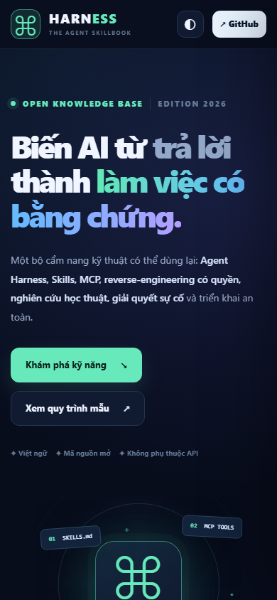

# QA REPORT — Agent Harness Skillbook

**Ngày chạy:** 2026-11-14 07:45:40 UTC (14:45:40 Việt Nam)  
**Repo:** trinhtanphat/agent-harness-skillbook  
**Commit kiểm thử:** e4d2f97bebb92670392dc96a67eec6a8f0c7875c  
**Site:** https://trinhtanphat.github.io/agent-harness-skillbook/  
**Môi trường:** DESKTOP-PHA1S90, Chrome headless, profile riêng tự tạo, không đụng Edge/Session 2.  
**Command:** node scripts/browser-qa.mjs https://trinhtanphat.github.io/agent-harness-skillbook/

## 7/7 Browser smoke checks PASS

| Hạng mục | Quan sát |
|---|---|
| Desktop catalog | 60 skills, 11 category buttons, không horizontal overflow ở 1440px |
| Search MCP | 7 kết quả phù hợp, filter hoạt động |
| Category Research | 6 skills, aria-pressed=true |
| Detail drawer | mở và đóng bằng UI thành công |
| Mobile 390px | 60 skills, viewport/scrollWidth đều 390 |
| Playbook mobile | 14 menu links, có heading và không overflow |
| Runtime JS exceptions | 0 |

## Hình ảnh kiểm chứng

[Chi tiết skill](evidence/2026-11-14/skill-detail-desktop.png) · [Trang playbook mobile](evidence/2026-11-14/docs-mobile-390.png)

## MCP protocol tests

Node smoke tests on WIN11-181: discovery, per-request metadata, tool listing, deterministic tool calls, validation error, unknown tool, version mismatch and missing metadata: PASS. Protocol revision: **2026-07-28**, reference: https://modelcontextprotocol.io/specification/2026-07-28.

## Giới hạn

- Đây là kiểm thử smoke, không phải nghiệm thu mọi tương tác và nội dung của 60 skill.
- Screenshot không thay cho human pixel-level art review.
- Trang tĩnh không thao tác hệ thống production và không có backend người dùng.
- GitHub Pages / commit cần kiểm tra lại sau mỗi cập nhật, không tự áp dụng kết quả cũ cho commit mới.
- Thông tin và mã ví dụ chỉ dùng cho nghiên cứu/phát triển có quyền.

**Quyết định:** PASS cho các kiểm tra ở bảng trên; các mục nằm ngoài phạm vi được ghi chưa kiểm chứng.

## Nghiệm thu bổ sung — 14/11/2026, commit f7024ca

### Browser 10/10 PASS trên PHA

Bổ sung thêm 3 phép thử so với đợt đầu: chuyển dark/light và phục hồi; lọc chuyên mục Git (6 skills); 14/14 URL playbook trên GitHub Pages trả 200. Cùng 7 kiểm thử cũ, tổng cộng 10/10. Chạy lại bằng Chrome headless với profile tạm riêng, không tác động phiên Edge người dùng.

### Đối chiếu live production GitHub Pages: 102/102 PASS

Chạy scripts/verify-pages.ps1 -Full trên WIN11-181, chỉ tải tài nguyên public về thư mục TEMP và đối chiếu **Git blob SHA** với HEAD f7024ca10979a3ddb16b0eb2afd2b2de1b95f3b0.

Kết quả thực tế: 102 tệp trong scope đều có nội dung byte-for-byte trùng Git HEAD, gồm 60 SKILL.md, 14 playbook Markdown, 14 trang HTML, 4 ảnh bằng chứng và các file website/metadata/mẫu MCP. Kết thúc lệnh: DEPLOY_INTEGRITY_PASS, exit code 0.

Kết quả này **không** chứng minh mọi nội dung học thuật hoặc mọi ứng dụng của skill đều được nghiệm thu; nó chứng minh triển khai tĩnh và các chức năng web đã kiểm tra. Việc sửa riêng báo cáo sau khi đo sẽ làm thay đổi HEAD, vì vậy phải chạy verifier lại với commit chứa ghi chú này trước khi công bố trạng thái cuối.
