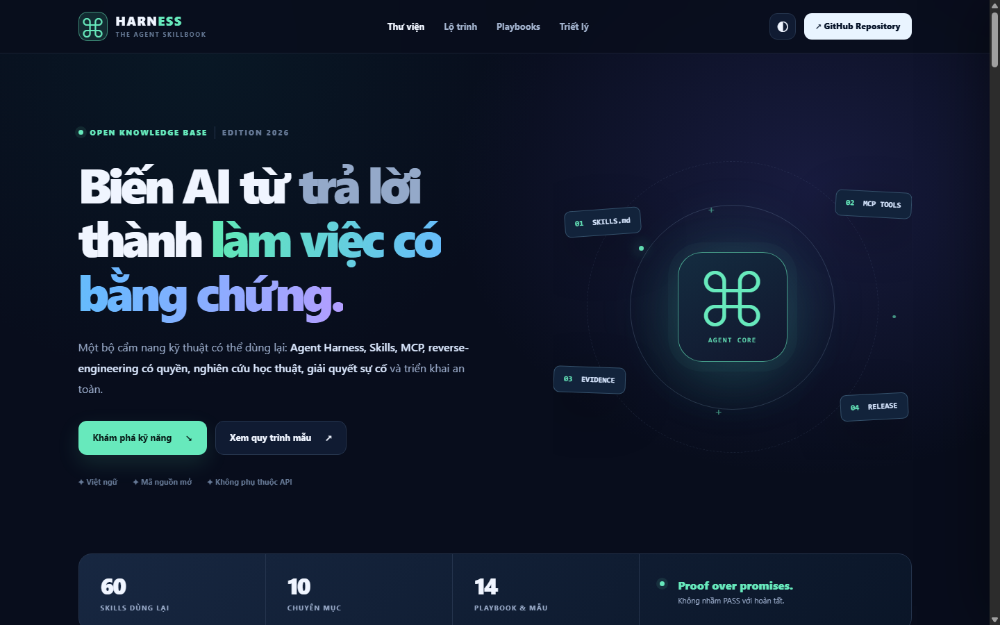

# Agent Harness Skillbook

**Kho kiến thức thực hành AI Engineering, Agent Harness, Skills và MCP bằng tiếng Việt.** Nội dung được viết thành các quy trình có phạm vi, quyền, output, testcase và bằng chứng. Tài liệu tự biên soạn dựa trên tiêu chuẩn/tài liệu công khai; không phải sản phẩm chính thức của các tổ chức được tham khảo.



🌐 **Website:** https://trinhtanphat.github.io/agent-harness-skillbook/  
📚 **Tài liệu:** [14 hướng dẫn dạng HTML](docs/index.html) · [60 SKILL.md](skills/index.html) · [Danh mục nguồn](REFERENCES.md)  
💡 **MCP mẫu:** [Server stdio 2026-07-28](examples/mcp-stdio-demo/)  
🔬 **Bộ kiểm thử:** [Validator](scripts/validate.mjs) · [Browser QA](scripts/browser-qa.mjs)

## 60 kỹ năng / 10 nhóm

| Nhóm | Ví dụ |
|---|---|
| Agent Harness & Skills | agent loop, trigger design, context/memory, multi-agent, evaluation |
| Crawl & App Reconstruction | quyền/scope, route map, API contract, visual QA, asset provenance |
| Research & PhD | research protocol, PRISMA, screening, dedupe, evidence synthesis |
| MCP & Integrations | host/client/server, OAuth/RBAC, permission, observability, schema |
| Problem Solving | scientific debugging, 5 Whys, RCA, incident, evidence reporting |
| QA, Security & Delivery | unit/integration/E2E, blue/green, rollbacks, security |
| Reverse Engineering & Forensics | static archaeology, sandbox, PE/ELF, PCAP, JS bundle |
| Knowledge & RAG | ingestion, PDF extraction, chunking, hybrid search, grounded eval |
| Git & Release Engineering | full Git mirror, LFS/submodules/releases, local CI, attestation |
| Data & Automation | crawler delta, durable scheduler, data invariants, idempotent queue |

## 14 playbooks

| Số | Chuyên đề |
|---|---|
| 01 | [Crawl & xây lại ứng dụng có quyền](docs/01-app-reconstruction.html) |
| 02 | [Nghiên cứu luận án có hệ thống](docs/02-phd-research.html) |
| 03 | [MCP & thiết bị từ xa](docs/03-mcp-integration.html) |
| 04 | [Giải quyết vấn đề gốc](docs/04-problem-solving.html) |
| 05 | [Agent Harness & Multi-agent](docs/05-agent-harness.html) |
| 06 | [QA & Blue/Green](docs/06-qa-release.html) |
| 07 | [Evidence ledger & nghiệm thu](docs/07-evidence-reporting.html) |
| 08 | [Security, quyền và đạo đức](docs/08-security-ethics.html) |
| 09 | [Đánh giá agent & chi phí](docs/09-evaluation-cost.html) |
| 10 | [Lộ trình 30 ngày](docs/10-learning-roadmap.html) |
| 11 | [Reverse engineering / Forensics](docs/11-reverse-forensics.html) |
| 12 | [Knowledge Engineering / RAG](docs/12-knowledge-rag.html) |
| 13 | [Git mirror toàn bộ refs, LFS, Releases](docs/13-full-github-mirror.html) |
| 14 | [Data pipelines & scheduler](docs/14-data-automation.html) |

## Khởi chạy / kiểm thử local

Yêu cầu Node 22+ cho bộ kiểm thử. Website chạy hoàn toàn tĩnh, không cần API, framework hay GitHub Actions.

~~~bash
git clone https://github.com/trinhtanphat/agent-harness-skillbook.git
cd agent-harness-skillbook
node --check assets/app.js
node --check data/catalog.js
node scripts/validate.mjs
node examples/mcp-stdio-demo/client-smoke.mjs
~~~

Browser QA với Chromium hoặc Edge headless **profile cách ly**:

~~~bash
node scripts/browser-qa.mjs https://trinhtanphat.github.io/agent-harness-skillbook/
~~~

Nếu không phát hiện browser binary, script sẽ SKIP minh bạch. QA images và browser-qa.json được ghi trong thư mục qa-evidence của workspace local (không tự động gửi dữ liệu đi).

## Dùng Skill

Đọc metadata và phạm vi SKILL.md, sau đó sử dụng trong hệ thống agent tương thích định dạng [Agent Skills](https://agentskills.io/specification). Chẳng hạn: [skill Git mirror](.agents/skills/complete-repository-mirror/SKILL.md).

## Nghiệm thu và đạo đức

Tách **IMPLEMENTED → TESTED → REVIEWED → DEPLOYED → PRODUCTION_VERIFIED → ACCEPTED**. HTTP 200, unit PASS hoặc SHA trùng không đủ tự chứng minh đầy đủ chức năng và chất lượng UI/asset. Không đưa credential, PII, nội dung riêng tư hoặc tài sản có bản quyền thiếu phép vào repository.

Các mẫu là tài liệu giáo dục; phải xác minh tool/SDK, giấy phép và quyền theo môi trường trước khi áp dụng. Repo sử dụng giấy phép MIT cho nội dung/mã do dự án biên soạn. Tư liệu bên thứ ba giữ nguyên bản quyền riêng.

Nguồn: [Agent Skills](https://agentskills.io/specification) · [MCP 2026-07-28](https://modelcontextprotocol.io/specification/2026-07-28) · [PRISMA](https://www.prisma-statement.org/) · [Playwright](https://playwright.dev/).

## Báo cáo QA có bằng chứng

Xem [QA_REPORT.md](QA_REPORT.md) và [ảnh mobile 390px](evidence/2026-11-14/home-mobile-390.png). Các ảnh được chụp trên Chrome headless profile riêng, không có tài khoản đăng nhập hoặc dữ liệu người dùng. Kết quả chỉ đại diện phạm vi test ghi trong báo cáo.

## Chia sẻ trực tiếp từng skill

Mở thư viện, chọn một skill, nhấn **Sao chép liên kết**. Ví dụ: [Complete Repository Mirror](https://trinhtanphat.github.io/agent-harness-skillbook/#skill/complete-repository-mirror). URL `#skill/<id>` có thể tải lại và mở đúng skill ngay, không cần tài khoản, backend hay API.

Website hỗ trợ tìm kiếm từ khóa, lọc 10 chuyên mục/độ khó, bật sáng/tối, `Ctrl+K` để tìm nhanh và `Esc` để đóng chi tiết. Bộ lọc giữ focus bàn phím và popup có focus trap.

## Xem trước và kiểm thử trước merge

Đọc [LOCAL_PREVIEW.md](LOCAL_PREVIEW.md) để khởi chạy server loopback không dependency, kiểm tra an toàn đường dẫn và chạy QA browser trên **nhánh riêng**:

```bash
node scripts/local-preview.mjs 8765
# hoặc chạy một lệnh mở server, test và tự đóng:
node scripts/test-local.mjs
```

Các file QA local được lưu trong `qa-evidence-local/` (đã gitignore). Không được coi test cục bộ là xác minh GitHub Pages; sau merge/deploy phải kiểm tra riêng.

Kiểm thử server loopback không cần trình duyệt: `node scripts/test-preview.mjs`. Bộ này kiểm tra HTTP status, file type, cấm `.git`/`.env`, HEAD và POST.

## Nghiệm thu cuối cùng (14/11/2026)

**16/16 Browser QA PASS — live GitHub Pages.** Chrome headless trên máy PHA đã kiểm tra trực tiếp website, bao gồm focus trap bằng Tab, Escape và browser Back. Kết quả: 0 JavaScript exception, 14/14 đường dẫn hướng dẫn hoạt động. [Biên bản QA](QA_REPORT.md) · [JSON 16 ca test](evidence/2026-11-14-final/browser-qa.json) · [Ảnh desktop](evidence/2026-11-14-final/home-desktop-1440.png) · [Ảnh mobile](evidence/2026-11-14-final/home-mobile-390.png). Đây là nghiệm thu smoke theo phạm vi xác định, không phải chứng nhận WCAG hoặc học thuật toàn diện.

## Truy cập theo danh mục và cài vào dự án

- [Danh mục 14 playbook trực tuyến](docs/index.html).
- [Danh mục 60 skills trực tuyến](skills/index.html).
- [Hướng dẫn cài an toàn vào dự án khác](install.html): dry-run mặc định, --write để cài, không ghi đè.
- Kiểm thử cài đặt: node scripts/test-install-skills.mjs (không phụ thuộc npm packages).

**Phát triển / QA:** thêm kiểm tra tự động hai trang chỉ mục, 60 deep links và bốn meta descriptions. Chạy `node scripts/validate.mjs`, `node scripts/test-install-skills.mjs` và `node scripts/browser-qa.mjs <site-url>` trên trình duyệt cô lập để nghiệm thu giao diện.

## Trạng thái kiểm thử công khai mở rộng

**19/19 Chrome browser smoke PASS** trên URL GitHub Pages public, gồm kiểm thử mới của danh mục 14 playbook, 60 skill trên mobile 390px và hướng dẫn cài. [Bằng chứng JSON](evidence/2026-11-14-19qa/browser-qa.json) · [Ảnh mobile](evidence/2026-11-14-19qa/skills-index-mobile-390.png) · [QA_REPORT](QA_REPORT.md). Đây là phạm vi smoke automation, không phải chứng nhận mọi môi trường.

## Kiểm toán bổ sung: 24/24 Browser QA

Đợt ngày 14/11/2026 bổ sung hỗ trợ điện thoại 320px, cách ly background khi popup mở, giảm chuyển động, mô tả SEO đúng 60 skill và bảo vệ preview khỏi symlink ra ngoài root. **24/24 Chrome browser smoke PASS trên website công khai**, 15 kiểm thử preview và kiểm thử cài 60 skill PASS. [Biên bản kiểm thử](QA_REPORT.md) · [Kết quả dòng lệnh](evidence/2026-11-14-a11y-24qa/live-browser-run.md). Không phải chứng nhận WCAG toàn diện.

## Kiểm tra bảo mật máy xem trước

Server preview chỉ lắng nghe `127.0.0.1`, chặn thư mục và tệp nhạy cảm sau khi giải quyết symlink (bao gồm đường dẫn bí danh bên trong root), không phân biệt chữ hoa/thường. Kiểm thử: `node scripts/test-preview.mjs` và [biên bản QA](evidence/2026-11-15-preview-security/QA.md). Mã hoạt động trên máy cục bộ; không phải cấu hình bảo mật của GitHub Pages.

## Một lệnh nghiệm thu (không cần GitHub Actions)

[Release Gate](RELEASE_GATE.md) gom các cổng QA theo thứ tự: `node scripts/release-gate.mjs --mode node` (6 bước), `--mode local` (7 bước, Chrome cô lập), `--mode release` (9 bước, bao gồm browser live và toàn vẹn GitHub Pages). Chế độ release đối chiếu `HEAD` với **SHA trực tiếp trên GitHub main** trước và sau QA; nếu sai, dừng ngay, không tự merge hoặc deploy. Xem trước bằng `--mode release --plan`.

**Bằng chứng lần chạy release thực tế:** [JSON 9/9 PASS](evidence/2026-11-15-release-gate/release-gate-public.json) — gồm SHA GitHub `main` trước/sau và phép đối chiếu 132/132 tệp trên GitHub Pages, tại commit `3abcabf`.

## Integrity kiểm toán mọi tệp Git-tracked

Chế độ `powershell -NoProfile -File scripts/verify-pages.ps1 -Full` hiện tự động lấy toàn bộ tệp được Git theo dõi (`git ls-files`) thay vì chỉ danh sách cố định. Mọi tệp vừa commit sẽ tự vào phạm vi so sánh byte trên GitHub Pages. Xem manifest không tải mạng: `powershell -NoProfile -File scripts/verify-pages.ps1 -Full -ListOnly`; `node scripts/test-release-gate.mjs` đối chiếu manifest này với toàn bộ Git-tracked paths. Phạm vi này không bao gồm untracked/ignored files; không chứng nhận bảo mật toàn diện.

**Bằng chứng release coverage:** [JSON 9/9 PASS](evidence/2026-11-15-full-coverage/release-gate-public.json) của lần xác minh toàn bộ **154/154 tệp** trên commit `a4d5cba`; SHA-256 được ghi trong [QA_REPORT](QA_REPORT.md). Lưu ý báo cáo cuối được bổ sung qua commit khác nên cần đối chiếu lại Pages sau khi phát hành.

## Ngăn xuất bản nhầm bí mật (Git HEAD)

**Release Gate nay chạy preflight riêng** để phát hiện tệp nhạy cảm hoặc dấu hiệu private key/token trong đúng Git HEAD trước khi tiếp tục kiểm thử website. Chạy `node scripts/audit-public-tree.mjs` và `node scripts/test-public-tree.mjs`; [giải thích giới hạn và mẫu nhận diện](PUBLIC_TREE_SECURITY.md). Kết quả không chứa nội dung khóa. Chế độ QA có **7 cổng Node**, **8 cổng local** và **10 cổng release**; trên production chỉ chốt khi 10/10 PASS. Không thay thế việc bật GitHub secret scanning hay rà soát lịch sử commit.

**Bằng chứng thực tế đã lưu:** [JSON Release Gate 10/10 PASS](evidence/2026-11-15-public-tree-security/release-gate-public.json) của commit `7e33a1e`. Kết quả này gồm preflight Git HEAD, Chrome QA và **159/159 GitHub Pages blobs**. Sau khi thêm bằng chứng, phải xác minh lại GitHub Pages trên HEAD mới.

## Kiểm toán lịch sử Git công khai

Bộ kiểm tra HEAD-only được bổ sung [kiểm toán lịch sử](PUBLIC_HISTORY_SECURITY.md) (`node scripts/audit-public-history.mjs`) để phát hiện **token hoặc đường dẫn nhạy cảm đã commit rồi xóa**, nhưng còn tồn tại trong commit tổ tiên. Các bài fixture sử dụng chuỗi giả, không in giá trị secret. Release Gate nâng lên **9 cổng Node, 10 cổng local, 12 cổng release**. Không kiểm tra refs ngoài nhánh HEAD hoặc toàn bộ Git history trên GitHub nếu chưa fetch.
